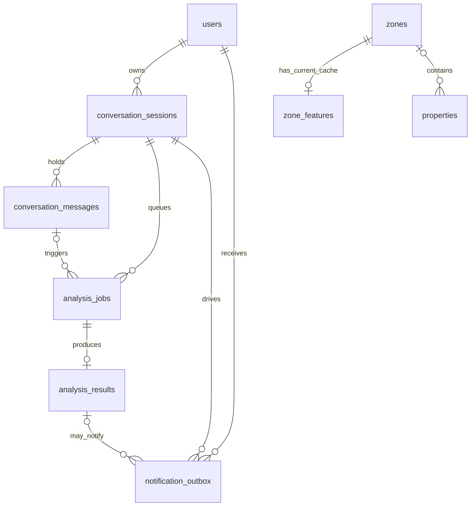

# Yoo Nai Dee — PostgreSQL Data Dictionary

**Version:** 1.0 | **Database:** PostgreSQL 15+ | **Scope:** Hackathon MVP  
**Companion files:** `yoo_nai_dee_prd.md`, `yoo_nai_dee_init.sql`  
**Source of truth:** Original Nov 19 context, revised by agreed flow: Conversation AI extracts profile only; Research Agent owns all third-party mapping/rental research; full results persist in PostgreSQL; LINE Push contains preview; authenticated LIFF fetches full result via API.

## 1. Design principles

- **10 tables**, grouped as Conversation (3), Async (2 incl. outbox), Research Cache (4), Results (1).
- All IDs are UUID; `gen_random_uuid()` is supported in modern PostgreSQL without additional extensions.
- Timestamps are `timestamptz`. App converts for presentation.
- JSONB holds evolving AI/profile/source/result data with **application-level Zod/JSON Schema validation**; SQL enforces top-level type only.
- `analysis_jobs.input_snapshot` is an immutable logical copy of profile when job was created. Do not update it mid-job.
- `analysis_results.result_data` is full, reproducible output. `line_preview` is a small derived JSON projection. LIFF never queries DB directly.
- The structure and size of provider data may be restricted by licensing; store only what provider terms allow. Do not store unnecessary personal data.

## 2. ER diagram



## 3. Schema dictionary

### `users` — LINE identity

| Column | SQL type | Null | Default | Meaning |
|---|---|---|---|---|
| `id` | uuid | NO | `gen_random_uuid()` | Internal user PK |
| `line_user_id` | text | NO | — | LINE user ID; unique; authorization key mapping |
| `display_name` | text | YES | — | Optional LINE display name |
| `created_at` | timestamptz | NO | `now()` | First seen |
| `updated_at` | timestamptz | NO | `now()` | Last modification; application-managed |

**Constraints:** PK `id`; UNIQUE `line_user_id`.

### `conversation_sessions` — Active conversation and latest structured profile

| Column | SQL type | Null | Default | Meaning |
|---|---|---|---|---|
| `id` | uuid | NO | UUID | Session PK |
| `user_id` | uuid | NO | — | FK to `users.id` |
| `state` | text | NO | `COLLECTING` | `COLLECTING`, `WAITING_FOR_USER`, `READY`, `ANALYZING`, `COMPLETED`, `CLOSED` |
| `preferences` | jsonb object | NO | `{}` | Latest structured HousingPreferenceProfile |
| `profile_schema_version` | integer | NO | `1` | Profile JSON contract version |
| `profile_version` | integer | NO | `0` | Increment when user preferences change |
| `profile_source_metadata` | jsonb object | NO | `{}` | Provenance of individual fields; explicit/inferred/default |
| `ready_for_analysis` | boolean | NO | `false` | Readiness gate output; computed by code |
| `awaiting_question` | text | YES | — | Outstanding clarification question |
| `next_message_sequence` | bigint | NO | `1` | Counter allocated under session row lock |
| `created_at` | timestamptz | NO | `now()` | Created |
| `updated_at` | timestamptz | NO | `now()` | Changed; application-managed |
| `closed_at` | timestamptz | YES | — | Set upon closing (mandatory for `CLOSED`) |

**Constraints/indexes:** FK `user_id`; one `closed_at IS NULL` session per user; index `(user_id, created_at DESC)`. Close prior session explicitly before starting another.

### `conversation_messages` — LINE chat history / deduplication

| Column | SQL type | Null | Default | Meaning |
|---|---|---|---|---|
| `id` | uuid | NO | UUID | Message PK |
| `session_id` | uuid | NO | — | FK to session |
| `sequence_no` | bigint | NO | — | Ordered number unique per session |
| `direction` | text | NO | — | `IN` or `OUT` |
| `line_message_id` | text | YES | — | LINE message ID when present; unique |
| `webhook_event_id` | text | YES | — | LINE webhook event ID; unique to dedupe |
| `content` | text | NO | — | Message text / safe summary |
| `payload` | jsonb object | NO | `{}` | Minimal event/message metadata, not secrets |
| `delivery_status` | text | YES | — | `PENDING`, `SENT`, `FAILED` for outgoing |
| `created_at` | timestamptz | NO | `now()` | Persist time |

**Constraints/indexes:** UNIQUE `(session_id, sequence_no)`; UNIQUE nullable webhook/message IDs; index `(session_id, sequence_no)`.

### `analysis_jobs` — PostgreSQL job queue for both AI stages

| Column | SQL type | Null | Default | Meaning |
|---|---|---|---|---|
| `id` | uuid | NO | UUID | Job PK |
| `session_id` | uuid | NO | — | FK to conversation session |
| `message_id` | uuid | YES | — | Optional originating conversation message FK |
| `job_type` | text | NO | — | `CONVERSATION` or `ANALYSIS` |
| `status` | text | NO | `QUEUED` | `QUEUED`, `PROCESSING`, `COLLECTING`, `SCORING`, `EXPLAINING`, `NEEDS_INPUT`, `WAITING_FOR_HANDLER`, `COMPLETED`, `FAILED` |
| `idempotency_key` | text | NO | — | Globally unique logical-job key |
| `profile_version` | integer | YES | — | Snapshot version (mainly `ANALYSIS`) |
| `input_snapshot` | jsonb object | NO | `{}` | Immutable job payload / user profile snapshot |
| `progress` | smallint | NO | `0` | 0–100 percentage for LIFF |
| `progress_detail` | jsonb object | NO | `{}` | e.g. stage label/current step/source availability |
| `attempts` | integer | NO | `0` | Claims/attempts used |
| `max_attempts` | integer | NO | `3` | Maximum claims incl. retries |
| `run_after` | timestamptz | NO | `now()` | Earliest next processing time |
| `lease_until` | timestamptz | YES | — | Lease expiration; recover orphaned work |
| `locked_by` | text | YES | — | Worker identifier while leased |
| `last_error` | text | YES | — | Redacted error summary |
| `created_at` | timestamptz | NO | `now()` | Created |
| `updated_at` | timestamptz | NO | `now()` | Last status mutation |
| `completed_at` | timestamptz | YES | — | When committed complete |

**Constraints/indexes:** UNIQUE `idempotency_key`; CHECK `attempts <= max_attempts`; ready/failed partial index `(run_after, created_at)`, running/lease partial index, session recent index. `FAILED` retries only when `attempts < max_attempts` and `run_after <= now()`; at the limit it is terminal. `NEEDS_INPUT` remains parked. The Java consumer also claims legacy `WAITING_FOR_HANDLER` ANALYSIS jobs, including rows inserted after the one-time migration. It claims with a 180-second lease, reads the saved snapshot and zones from PostgreSQL, writes a demo result, marks the job `COMPLETED`, and queues the final LINE notification in one transaction. No analysis provider HTTP call runs. Expired leases become `FAILED`; retries are delayed by `min(300, 5 * 2^(attempts-1))` seconds.

The notification sender reads `line.channel-access-token` from its active Spring profile and pushes the completion Flex after commit. The result has no scores or unsupported location facts. Apply `docs/migrations/20261121_demo_analysis_completion.sql` after the two earlier analysis migrations.

The completion migration requeues old `WAITING_FOR_HANDLER` jobs and cancels pending progress acknowledgements. `input_snapshot` and `profile_version` stay unchanged.

### `zones` — Master candidate residential neighborhoods

| Column | SQL type | Null | Default | Meaning |
|---|---|---|---|---|
| `id` | uuid | NO | UUID | Zone PK |
| `slug` | text | NO | — | Stable unique zone key |
| `name_th` | text | NO | — | Thai name |
| `name_en` | text | YES | — | English name |
| `center_lat` | numeric(10,7) | YES | — | WGS84 latitude; null for unsourced demo zones |
| `center_lng` | numeric(10,7) | YES | — | WGS84 longitude; null for unsourced demo zones |
| `boundary` | jsonb object | YES | — | Optional GeoJSON geometry, application validated |
| `is_active` | boolean | NO | `true` | Eligible for research |
| `created_at` | timestamptz | NO | `now()` | Created |
| `updated_at` | timestamptz | NO | `now()` | Modified |

**Constraints/indexes:** UNIQUE `slug`; coordinate range checks. No PostGIS dependency for MVP. Area definitions must be agreed before score comparisons.

### `zone_features` — Reusable research metrics (current snapshot per zone)

| Column | SQL type | Null | Default | Meaning |
|---|---|---|---|---|
| `id` | uuid | NO | UUID | Row PK |
| `zone_id` | uuid | NO | — | Unique FK to `zones.id`, CASCADE on delete |
| `features` | jsonb object | NO | `{}` | POI counts/accessibility/normalized facts independent of user |
| `source_metadata` | jsonb object | NO | `{}` | Provider, observed-at, caveats, coverage |
| `confidence` | numeric(4,3) | YES | — | Data confidence 0–1; not ranking score |
| `computed_at` | timestamptz | NO | `now()` | Materialized time |
| `expires_at` | timestamptz | NO | — | Recompute after expiry |

**Constraints/indexes:** UNIQUE `zone_id`; index `expires_at`. Never store user's workplace commute here; personalized commutes belong in results.

### `properties` — Rental listing snapshots/references

| Column | SQL type | Null | Default | Meaning |
|---|---|---|---|---|
| `id` | uuid | NO | UUID | Internal listing PK |
| `zone_id` | uuid | YES | — | Optional FK to zone; SET NULL on delete |
| `source` | text | NO | — | Provider name/key |
| `external_id` | text | NO | — | Original listing key |
| `title` | text | NO | — | Listing title from source |
| `rent_price` | numeric(12,2) | YES | — | Monthly THB or explicit currency; NULL when not supplied |
| `currency` | char(3) | NO | `THB` | ISO-style currency code |
| `lat` | numeric(10,7) | YES | — | Coordinates if supplied/licensed |
| `lng` | numeric(10,7) | YES | — | Coordinates if supplied/licensed |
| `listing_url` | text | YES | — | External source link |
| `image_urls` | jsonb array | NO | `[]` | Licensed/allowed listing images |
| `raw_data` | jsonb object | NO | `{}` | Minimal permitted provider fields |
| `source_updated_at` | timestamptz | YES | — | Provider-side update timestamp |
| `fetched_at` | timestamptz | NO | `now()` | Last retrieval |
| `expires_at` | timestamptz | YES | — | Refresh/expiration |

**Constraints/indexes:** UNIQUE `(source, external_id)`; index `(zone_id, rent_price)` and `expires_at`. Only show real or authorized demonstration listings.

### `api_cache` — Third-party API responses (provider + normalized input)

| Column | SQL type | Null | Default | Meaning |
|---|---|---|---|---|
| `cache_key` | text | NO | — | PK; stable hash including provider/request/schema version |
| `provider` | text | NO | — | e.g. Overpass/ORS/rental provider |
| `response_data` | jsonb | NO | — | Permitted response content |
| `fetched_at` | timestamptz | NO | `now()` | Fetch time |
| `expires_at` | timestamptz | NO | — | Cache expiry |

**Constraints/indexes:** PK `cache_key`; index `expires_at`. Example suggested TTLs: POI 7d, routing 24h, listings 6–24h; verify provider terms and quota.

### `analysis_results` — Full immutable LIFF result + small LINE preview

| Column | SQL type | Null | Default | Meaning |
|---|---|---|---|---|
| `id` | uuid | NO | UUID | Result ID; LIFF route identifier, not auth token |
| `job_id` | uuid | NO | — | Unique FK to `analysis_jobs.id` (1:0..1) |
| `profile_snapshot` | jsonb object | NO | — | Profile actually used for recommendation |
| `result_schema_version` | integer | NO | `1` | Output JSON contract version |
| `scoring_version` | text | NO | `v1` | Deterministic scoring algorithm version |
| `result_data` | jsonb object | NO | — | FULL result: Top 3, score breakdowns, sources, trade-offs, properties |
| `line_preview` | jsonb object | NO | `{}` | Small preview for Flex Message (no full result dump) |
| `created_at` | timestamptz | NO | `now()` | Result persistence time |

**Constraints/indexes:** UNIQUE `job_id`. Fetch through owner-authorized API: result -> job -> session -> user.

### `notification_outbox` — Reliable LINE Push intents

| Column | SQL type | Null | Default | Meaning |
|---|---|---|---|---|
| `id` | uuid | NO | UUID | Outbox row PK |
| `user_id` | uuid | NO | — | Destination LINE user FK |
| `session_id` | uuid | NO | — | Origin session FK |
| `analysis_result_id` | uuid | YES | — | Optional result FK; required for completed analysis |
| `idempotency_key` | text | NO | — | Prevent duplicate notification intents |
| `notification_type` | text | NO | — | `CONVERSATION_MESSAGE`, `ANALYSIS_ACKNOWLEDGED`, `ANALYSIS_COMPLETED`, `ANALYSIS_FAILED` |
| `status` | text | NO | `PENDING` | `PENDING`, `PROCESSING`, `SENT`, `FAILED` |
| `payload` | jsonb object | NO | `{}` | LINE Push preview/text/link only; no full result |
| `attempts` | integer | NO | `0` | Attempts |
| `max_attempts` | integer | NO | `3` | Retry cap |
| `next_attempt_at` | timestamptz | NO | `now()` | Retry schedule |
| `lease_until` | timestamptz | YES | — | Delivery lease expiry |
| `locked_by` | text | YES | — | Notification worker name |
| `last_error` | text | YES | — | Sanitized delivery error |
| `sent_at` | timestamptz | YES | — | Successful delivery response time |
| `created_at` | timestamptz | NO | `now()` | Enqueued |
| `updated_at` | timestamptz | NO | `now()` | Last modified |

**Constraints/indexes:** UNIQUE `idempotency_key`; `ANALYSIS_COMPLETED` requires result FK; retry/lease/session indexes. **At-least-once** outgoing messaging; use provider idempotency support when supported. The outbox is also used for questions from Conversation AI.

## 4. JSON contract reference

### 4.1 `conversation_sessions.preferences` and `analysis_jobs.input_snapshot`

See **PRD Part 1 §1.3** for the `HousingPreferenceProfile` v1 example. Snapshot should copy the validated profile JSON plus schema version and its current `profile_version`; avoid making Research Agent read latest mutable preferences.

Suggested field provenance shape:

```json
{
  "budget.maxMonthlyRent": {"source": "user_explicit", "messageId": "uuid", "confidence": 1.0},
  "transport.primary": {"source": "user_explicit", "messageId": "uuid", "confidence": 1.0}
}
```

### 4.2 `analysis_results.result_data`

See **PRD Part 2 §2.5**. Must include `summary`, `recommendations` (ordered Top 3 if available), score breakdowns, evidence/uncertainties, actual properties (or an empty array), and sources/limitations. Numeric values computed in code, not made up by AI.

### 4.3 `analysis_results.line_preview` and outbox `payload`

```json
{
  "title": "วิเคราะห์ทำเลเรียบร้อยแล้ว",
  "zoneNames": ["อันดับ 1", "อันดับ 2", "อันดับ 3"],
  "liffUrl": "https://example.invalid/analysis/RESULT_UUID"
}
```

This is an **illustrative nonworking URL**; the app builds the real LIFF deep link using configured LIFF ID/URL and `analysis_results.id`. Do not include secrets or full `result_data`.

## 5. Transaction/ownership rules

1. **Inbound LINE webhook:** signature verification -> dedupe by `webhook_event_id` -> transaction inserting message and `CONVERSATION` job -> respond HTTP 200 fast.
2. **Message ordering:** acquire session row lock, allocate/increment `next_message_sequence` transactionally. Serialize per-session conversation jobs.
3. **Profile update:** merge only new explicit changes; increment `profile_version`; validate readiness; if ready create `ANALYSIS` job with snapshot in transaction.
4. **Research complete:** transaction inserts full `analysis_results`, updates `analysis_jobs` to `COMPLETED`, inserts `notification_outbox(PENDING)`; commit before LINE Push. Unique keys guard duplicate finish attempts.
5. **LIFF GET result:** authenticate LINE identity server-side and enforce ownership along `analysis_results.job_id -> analysis_jobs.session_id -> conversation_sessions.user_id -> users.line_user_id`.
6. **LINE Push:** notification worker sends only preview/clarification; retries do **not** re-run research.
7. **Retention policy:** TBD for LINE text, profiles and third-party snapshots; set data minimization and clean-up before production.

## 6. Selected queries / indexes

- Last session by user: `ix_sessions_user_created`; only one session with `closed_at IS NULL` (`ux_sessions_one_open_per_user`).
- Recent chat: `ix_messages_session_sequence`.
- Queue worker: `ix_jobs_ready`, `ix_jobs_expired_leases`; claim with transaction + `FOR UPDATE SKIP LOCKED`.
- Listing filters: `ix_properties_zone_price`.
- Cache purge: `ix_api_cache_expiry`, `ix_zone_features_expiry`.
- LINE delivery: `ix_notifications_ready`, `ix_notifications_lease`.
- Results ownership: unique `analysis_results.job_id` plus PK/FK lookup chain.

## 7. Decisions and deliberate MVP simplifications

- No separate `user_preferences`, `zone_scores`, `property_scores`, or `liff_pages` tables. Evolving data lives in **validated JSONB**, with stable top-level relational identifiers.
- No PostGIS; simple WGS84 coordinates and optional GeoJSON; geospatial overlap/distance computed by application/third-party. Consider PostGIS only if geographic filtering grows.
- Cached `zone_features` has one **current** snapshot per zone (history lives in results/source metadata as allowed).
- Exactly 10 tables in this version. Add notification outbox vs original 9-table proposal; use it for *both* clarification pushes and completion messages.
- Open issues inherited from context: listing API licensing, transit mode coverage, actual zone boundaries, provider quota and LIFF authentication configuration.
