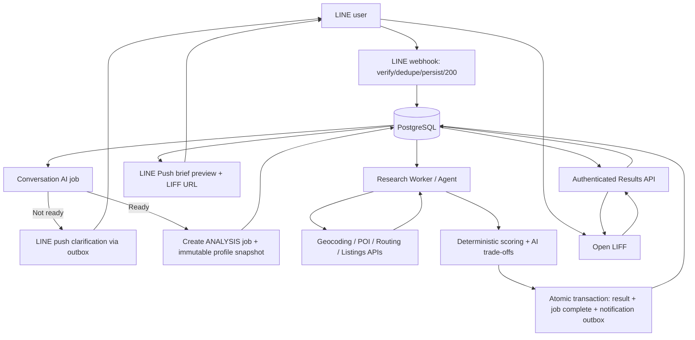

# Yoo Nai Dee — Product Requirements Document (PRD)

**Version:** 1.0 — Hackathon MVP  
**Status:** Implementation specification / proposed defaults where marked  
**Project:** อยู่ไหนดี (Where Should I Live?)  
**Stack:** LINE OA + LINE LIFF + Next.js/Node.js + PostgreSQL + OpenAI API; Railway single project

## 0. Product purpose and shared boundaries

Users describe living preferences in natural Thai through LINE OA. The system asks only essential clarification questions and recommends **Top 3 residential zones**, with rationales, trade-offs, and real/authorized rental listings. AI is a core orchestrator, not a static rules engine with an AI-written caption.

**Confirmed division of responsibility (latest agreement):**

1. **Conversation AI:** Read and summarize LINE conversations into a structured user-preference profile. Ask clarifying questions when truly necessary. Do **not** research neighborhoods or call Map/POI/Routing/Rental APIs.
2. **Background Research Agent:** Consume the structured profile snapshot from an `ANALYSIS` job; perform geocoding as needed, invoke third-party data tools, normalize evidence, score zones/properties via deterministic code, generate evidence-based trade-offs, and persist the **full** output in PostgreSQL.
3. **LINE / LIFF + Results API:** LINE messages contain a **brief preview only** and a LIFF deep link. When opened, LIFF calls the backend Results API; the API authorizes the user and reads full data from PostgreSQL. LIFF never accesses PostgreSQL directly.

**Note on source-vs-updated design:** The 19 Nov context mentioned validating/resolving workplace in Stage 1. Per the latest conversation, third-party map/geocoding belongs to Stage 2. Stage 1 validates that a destination description was supplied; Stage 2 resolves coordinates. Ambiguity discovered by Stage 2 returns a clarification request to Stage 1.

### High-level flow



### Shared design constraints

- **Hackathon-first:** 1 Railway app container running Next.js and a long-running worker loop (1 replica to start), plus Railway PostgreSQL. Logical separation in code; independent worker process/service is optional later. Do not spawn work using fire-and-forget in webhook requests.
- **Queue/storage:** PostgreSQL `analysis_jobs`; retries, leases, `FOR UPDATE SKIP LOCKED`, idempotency and session-level serialization. No Redis, Kafka, S3 or separate auth system for MVP.
- **External facts:** LLMs never invent listing prices, travel times, route modes, coordinates, scores or provider responses. Tools must return evidence with timestamps; code computes numeric scoring.
- **Failure UX:** A job failure or missing provider data is reported honestly, not converted to fabricated recommendations.
- **Privacy:** Only collect information relevant to recommendations. Protect LINE identity tokens, provider credentials and access to recommendation results.

---

# Part 1 — Conversation AI (LINE Chat and preference collection)

## 1.1 Goal

Turn one or many user messages into a coherent, versioned `HousingPreferenceProfile`. Keep asking only questions that materially improve the quality/readiness of the research request. Never run map/listing/commute research in this stage.

## 1.2 Scope

**In scope:** LINE webhook verification/deduplication, inbound message persistence, asynchronous `CONVERSATION` jobs, conversation continuity, intent/constraint extraction, profile merging, clarification, code-based readiness validation, acknowledgement and creation of `ANALYSIS` jobs. LINE Push is sent through a notification outbox.

**Out of scope:** Third-party map/routing/POI/rental API calls, zone/properties ranking, calculation of travel time, sending complete results to LINE, a form-first onboarding flow.

## 1.3 Required input and output

- Input: LINE user identity and event, new text message, previously persisted messages, current `conversation_sessions.preferences` and session state.
- Output: persisted session profile, `profile_version`, `profile_source_metadata`, readiness state; one follow-up LINE message when not ready OR one `ANALYSIS` job with a **point-in-time** `input_snapshot` when ready.

### Profile contract v1 (illustrative, not fabricated user data)

```json
{
  "schemaVersion": 1,
  "destinations": [{
    "type": "workplace",
    "name": "อโศก",
    "location": {"lat": null, "lng": null, "resolved": false},
    "frequencyPerWeek": null
  }],
  "budget": {"maxMonthlyRent": 15000, "currency": "THB", "strict": true},
  "transport": {"primary": "public_transit", "preferredModes": ["BTS", "MRT"]},
  "constraints": {"maxCommuteMinutes": null, "commuteIsStrict": false},
  "lifestyle": {
    "gym": {"importance": "high"},
    "streetFood": {"importance": "high"}
  },
  "housing": {"propertyTypes": [], "minAreaSqm": null, "furnished": null}
}
```

`ready_for_analysis` is stored as a **database state** after deterministic validation rather than being blindly trusted from LLM JSON. Keep explicit user constraints distinct from inferred/default fields; unknown is `null`, not a guessed number. `profile_source_metadata` records provenance (e.g. `user_explicit`, `assumed_default`, message reference).

## 1.4 Readiness rules

Minimum to trigger research: **destination description**, **maximum monthly rental budget**, **primary transport mode**, and **selected category weights totaling 100%**. Exact coordinates are **not required at this stage**. In Research Stage, the destination must successfully resolve to coordinates for routing. Optional needs (gym, food, max commute, housing type) should not block analysis unless the user's wording makes them essential/hard constraints.

If user says “เริ่มหาเลย”, use documented defaults for optional data only. Never default a missing workplace or invent a budget. If location is ambiguous, Stage 2 may request clarification by setting job `NEEDS_INPUT` and session `WAITING_FOR_USER` and enqueueing an appropriate LINE question.

## 1.5 Functional requirements and acceptance criteria

| ID | Requirement | Acceptance / observable behavior |
|---|---|---|
| CA-01 | Verify LINE signature and store incoming event | Invalid signature rejected; valid event persisted and HTTP 200 returned without waiting for LLM |
| CA-02 | Deduplicate webhook messages | Same `webhook_event_id` creates at most one inbound record and one `CONVERSATION` job |
| CA-03 | Keep messages ordered per session | Bursts of user messages cannot overwrite the latest profile or reorder semantic updates |
| CA-04 | Extract/merge structured profile via AI | “เพิ่มงบเป็น 18,000” updates only budget and increments `profile_version` |
| CA-05 | Validate hard vs soft preferences | Exact, vague and inferred values remain distinguishable |
| CA-06 | Ask for clarification when not ready | One relevant question via LINE Push; session becomes `WAITING_FOR_USER` |
| CA-07 | Enqueue `ANALYSIS` job when ready | `input_snapshot` freezes the profile and `profile_version`; idempotency prevents duplicate jobs |
| CA-08 | Never call research APIs | No map, POI, Routing or Rental integrations imported/executed by Conversation AI |
| CA-09 | Support return-to-conversation | The next user answer is matched to the pending session/question and revalidated |

## 1.6 State and failure handling

Session states: `COLLECTING`, `WAITING_FOR_USER`, `READY`, `ANALYZING`, `COMPLETED`, `CLOSED`. A new preference change may produce a new analysis job; stale jobs/results stay associated with the input profile snapshot that generated them. `CONVERSATION` job failures retry with backoff; session history is retained. Notifications have independent retry state.

---

# Part 2 — LINE LIFF & APIs to display data

## 2.1 Goal

Offer a read-only, trustworthy result experience. LINE communicates briefly; LIFF renders full recommendation details retrieved from authorized backend APIs.

## 2.2 LINE Messaging UX

- Clarification messages: short questions from Part 1.
- Analysis started: short acknowledgment; no large data payload.
- Analysis complete: **Flex Message preview** with completion text, optional Top 3 **names**, and a “ดูรายละเอียด” LIFF link. Do not send full `analysis_results.result_data` to LINE.
- If jobs fail or require clarification, send an honest status/request rather than fake ranked results.
- All outgoing Push messages are delivered by the notification worker from `notification_outbox`, after database commit. LINE Push availability, limits and message rights must be verified with the actual LINE account.

## 2.3 LIFF Screens (MVP)

1. **Progress:** `QUEUED`, `PROCESSING`, `COLLECTING`, `SCORING`, `EXPLAINING`, `NEEDS_INPUT`, `COMPLETED`, `FAILED` with progress percentage/stage where available.
2. **Top 3 zone overview:** Zone names, scores, confidence (separate from scores), rationale, key pros/cons and trade-offs.
3. **Zone details:** Map/geographic context, available POIs, commuting evidence and limitations, ranked rental listings with real price, source link, image (only where rights permit), and fetch/update timestamps.
4. **Empty/partial data:** Explicit gaps (e.g. missing transit estimate, no listings within budget), no fabricated listing cards.

## 2.4 HTTP API contract (proposed; confirm URLs at implementation)

| API | Authorization | Response | Notes |
|---|---|---|---|
| `POST /api/line/webhook` | Verify `X-Line-Signature` | `200` accepted, `4xx` invalid | Persist/dedupe/enqueue only; return promptly |
| `GET /api/jobs/{jobId}` | Validated LINE identity, ownership | `{id,type,status,progress,progressDetail,updatedAt}` | LIFF polls every ~2–3s |
| `GET /api/analyses/{resultId}` | Validated LINE identity, ownership | Full versioned recommendation JSON | Reads PostgreSQL; never runs Research Agent |
| `GET /api/analyses/{resultId}/zones/{zoneId}` | Validated LINE identity, ownership | A selected zone derived from saved results | Optional; can use main analysis endpoint alone for MVP |

**Security:** LIFF obtains LINE identity authorization, sends a token to the server; backend validates token with LINE and verifies that resource owner (`analysis_jobs.session_id` -> `conversation_sessions.user_id` -> `users.line_user_id`) matches the authenticated LINE user. UUID/result ID alone is not authorization. Keep DB credentials server-side. Use HTTPS and avoid logging raw identity tokens.

## 2.5 Suggested persisted result contract (`result_schema_version: 1`)

```json
{
  "summary": {"zonesAnalyzed": 12, "recommendedCount": 3},
  "recommendations": [
    {
      "zoneId": "example-zone-id",
      "rank": 1,
      "zoneName": "example-zone-name",
      "overallScore": 87.5,
      "confidence": 0.82,
      "scores": {"commute": 90, "affordability": 85, "lifestyle": 88},
      "pros": ["example evidence-backed advantage"],
      "cons": ["example evidence-backed disadvantage"],
      "reasoning": "evidence-backed text only",
      "commute": {"mode": "unknown", "minutes": null, "source": null},
      "nearbyPlaces": [],
      "properties": []
    }
  ],
  "sources": [],
  "dataLimitations": []
}
```

The example values are **contract illustrations only**, not live scores. The `line_preview` field stores the small subset of this output used in the Push message. For stable auditability, results are frozen per job and versioned; LIFF renders them without recomputing.

## 2.6 Acceptance criteria

| ID | Acceptance |
|---|---|
| LF-01 | LINE completion Push contains preview + a valid LIFF link, not full analysis payload |
| LF-02 | LIFF fetches results only via authorized backend HTTP APIs |
| LF-03 | User A cannot retrieve User B's result using a copied result ID |
| LF-04 | Refreshing LIFF returns the persisted result without repeating third-party API calls |
| LF-05 | When result is not ready, progress screen displays persisted job state |
| LF-06 | Partial external data and source limitations are labeled clearly |

---

# Part 3 — Background Worker / Research Agent

## 3.1 Goal

Process PostgreSQL jobs independently of Frontend/LIFF, retrieve third-party evidence and produce consistent, evidence-backed rankings. Stage 2 is the **sole owner of maps, geocoding, POI, routing and rental-data integrations**.

## 3.2 Runtime and components

Long-running Node.js worker loop in the **same Railway app container** as Next.js for MVP, but with separate modules/interfaces:

- `jobRunner`: claim/lease/retry/recover `CONVERSATION` and `ANALYSIS` jobs (logical handlers separated).
- `researchAgent`: select research plan and tool calls based on a validated, immutable profile.
- `toolAdapters`: geocoding, OSM/Overpass POI, routing (ORS for supported modes only), rental provider (availability/rights to be confirmed), optional transit data.
- `featureBuilder`: normalize source records into zone features and location/accessibility measures.
- `scoringEngine`: deterministic hard filters, numeric normalization/weighting and zone/property ranking.
- `explanationAgent`: evidence-based Top 3 pros, cons, trade-offs; no invented numerical claims.
- `resultRepository`: transactional persist; `notificationWorker`: separate Push delivery from outbox.

AI can plan relevant tools, propose weights within guardrails and interpret trade-offs; numerical scores are computed in code with a recorded `scoring_version`.

## 3.3 Workflow (analysis job)

1. Claim eligible `ANALYSIS` job with `FOR UPDATE SKIP LOCKED`; acquire lease, increment attempts, read `input_snapshot`, and validate schema/version.
2. Resolve destination text to coordinates. If ambiguous, **do not guess**: mark job `NEEDS_INPUT`, session `WAITING_FOR_USER`, create a clarification outbox message, and let Conversation AI handle next reply.
3. Choose candidate zones (MVP ~10–20 predefined zones), pull/reuse POI, geocoding, supported Routing and Rental listing data via adapters and `api_cache`.
4. Normalize/cache reusable zone features in `zone_features`. Keep personalized commute scores in the analysis, not in global reusable features.
5. Check hard constraints first; apply deterministic normalized scoring (0–100), guardrailed weights and rank zones, then properties. Treat unknown feature as missing/low-confidence rather than automatically 0.
6. AI generates prose explaining top three zones and explicit trade-offs using only observed/derived facts.
7. In **one PostgreSQL transaction**: insert full `analysis_results` (including `profile_snapshot`, `result_data`, `line_preview`, versions); mark job `COMPLETED`; insert `notification_outbox` with `PENDING`. Commit **before** messaging LINE.
8. Notification worker claims outbox row, sends LINE Push with small preview and LIFF URL, then marks `SENT`; failures retry with lease/backoff. External network delivery is at-least-once; ambiguous timeouts may cause duplicate pushes.

## 3.4 External sources / validation

| Source | Purpose | Guardrail |
|---|---|---|
| OpenStreetMap / Overpass | Gyms, shops, food, parks, stations | Use caching, rate limits; coverage may be incomplete |
| Openrouteservice | Routing/commute where its modes work | Do **not** label driving as BTS/MRT or motorcycle time |
| Rental listing provider (to be validated; e.g. Scrappa/DDproperty) | Rental availability, price, photos, URL | Validate coverage, access rights and Terms before building demo |
| GTFS / transit data | Transit routes/times | Optional; no fake live transit estimate without supporting data |
| Licensed/authorized demo listing snapshot | Fallback if live API fails | Do not invent real-world listings |

Example cache TTLs proposed in context (not provider guarantees): POI 7 days, routing 24 hours, rental 6–24 hours; configurable by source and cache key. Geo boundaries optional, active zones centrally defined in `zones`.

## 3.5 Job status semantics

| Status | Meaning |
|---|---|
| `QUEUED` | Waiting for worker |
| `PROCESSING` | Claimed, general processing or conversation work |
| `COLLECTING` | Research pulling/normalizing external evidence |
| `SCORING` | Deterministic ranking |
| `EXPLAINING` | AI writing explanation |
| `NEEDS_INPUT` | Parked; clarify with user and later enqueue a fresh analysis job |
| `COMPLETED` | Full result committed to DB |
| `FAILED` | Error; retryable while `attempts < max_attempts`, otherwise terminal |

Progress state stored in `analysis_jobs`; LIFF polls DB through API. Retry uses `run_after`, `lease_until`, `locked_by`, `attempts`, `max_attempts` and `last_error`. Acquire/renew a lease while running; recover expired leases. Deduplicate job creation by `idempotency_key`. Serialize conversation jobs per session.

## 3.6 Acceptance criteria

| ID | Acceptance |
|---|---|
| BW-01 | Worker continues processing after webhook has already returned HTTP 200 |
| BW-02 | Two competing workers cannot both claim the same eligible job simultaneously |
| BW-03 | Expired leases and transient API errors retry without corrupting analysis results |
| BW-04 | Tool adapters and Scoring Engine execute under Research Stage, never Conversation Stage |
| BW-05 | Travel estimates and listing prices always identify source or explicit unavailability |
| BW-06 | Persisting a full result and scheduling its notification is atomic |
| BW-07 | LINE receives preview only; LIFF receives full result from PostgreSQL |
| BW-08 | Re-running an analysis for changed preferences creates a new job/snapshot; old results remain reproducible |

---

## 4. Traceability to PostgreSQL schema

| Product responsibility | Tables |
|---|---|
| LINE identity, conversation and profile | `users`, `conversation_sessions`, `conversation_messages` |
| Async queue and progress | `analysis_jobs` |
| Candidate zones, reusable POIs/features, listings, third-party cache | `zones`, `zone_features`, `properties`, `api_cache` |
| Full versioned LIFF result + LINE preview projection | `analysis_results` |
| Reliable LINE Push/clarification delivery | `notification_outbox` |

## 5. Out of scope / open decisions

**Deferred:** Full real-time BTS/MRT routing, nationwide zone coverage, Kafka/Redis, S3, flood/disaster score, complex multi-agent debate, custom login/auth outside LINE, production multi-replica scalability.

**Confirm before integration:** Actual rental API provider and licensing/usage rights, map/geocoding provider coverage, mode support for public transit, LINE quota/permissions, OAuth/LIFF settings, Railway budget and chosen OpenAI model/quota. Do not treat these as confirmed facts from the handoff.

## 6. MVP test scenarios

1. User supplies workplace/budget/transport in one LINE message -> one conversation job -> one analysis job.
2. User omits transport -> Conversation AI asks one targeted question; no research API call.
3. Duplicate LINE webhook arrives -> no duplicate inbound message/job.
4. User changes budget during processing -> running job remains tied to old `input_snapshot`; subsequent job uses new profile version.
5. Research cannot resolve vague workplace -> user clarification flow; no invented coordinates.
6. Research completes -> full result saved; DB transaction schedules notification; LINE previews only names/link.
7. Open LIFF while job is running -> progress; after completion -> full details without recomputing.
8. Another LINE user tries copied result URL -> 403/404 (no data leakage).
9. Rental API unavailable -> show honest limitation/authorized demo fallback; no fake listings.
10. Notification delivery fails -> independent retry without re-running research.

**Associated files:** `yoo_nai_dee_data_dictionary.md`, `yoo_nai_dee_init.sql`.

### Running the LINE intake locally

The web app and intake worker use `docs/yoo_nai_dee_init.sql` as their shared schema. Apply it to your PostgreSQL database. Copy `.env.example` to `.env` and set `DATABASE_URL`, `LINE_CHANNEL_SECRET`, `LINE_CHANNEL_ACCESS_TOKEN`, `OPENAI_API_KEY`, and `OPENAI_MODEL` (a Responses model that supports Structured Outputs).

Run `npm run dev` and, in a separate process, `npm run intake:worker`. Set your LINE Messaging API webhook URL to your public HTTPS app URL plus `/api/line/webhook`. The worker consumes `CONVERSATION` jobs and sends its own outbox messages by LINE Push. The research worker can consume queued `ANALYSIS` rows using `input_snapshot.profile` and `input_snapshot.profileVersion`. It needs to be configured separately. A search-area destination anchors a search for someone who has no regular commute and should be treated accordingly by research.

For a smoke check, send “อยากได้คอนโดใกล้ยิมกับตลาด ทำงานอโศก งบไม่เกิน 15,000 บาทต่อเดือน”. The bot should ask about transportation. Reply “BTS”, then “ยืนยัน” when it suggests a weight split. Check that an `ANALYSIS` job contains the destination, rent ceiling, BTS preference, gym and market priorities, and condo preference. This intake uses the configured OpenAI model.

### Trace a real LINE OA message

Register the public HTTPS `/api/line/webhook` URL for your Messaging API channel and enable **Use webhook**. Configure the web app and intake worker with the same `DATABASE_URL`. The LINE Console's **Verify** action can send an empty batch. Expect `line.webhook.accepted` with `eventCount: 0` for that check.

Send a one-to-one text message to the OA as a LINE user. Open the web app and worker logs and follow the same `jobId` through these entries:

| Log entry | What it confirms |
| --- | --- |
| `line.webhook.queued` | The signed LINE message was saved and a conversation job was queued. |
| `line.agent.started` | The worker picked up the job and is calling the agent. |
| `line.agent.completed` | Agent output was validated and the reply was queued. `clarificationNeeded` and `analysisQueued` show which path ran. |
| `line.push.accepted` | The LINE API accepted the outbound reply. Check the OA chat to confirm receipt. |

If the trace stops after queueing, check for `line.worker.ready` and verify both processes use the same database. `line.agent.failed` identifies an extraction failure. `line.push.failed` shows the HTTP status if LINE returned a response. The trace omits message text, LINE user IDs, and credentials.

### Housing preferences in LINE and on the web

The intake agent saves the selected catalog categories, their named places (or an empty list for any nearby place), and their weights in `conversation_sessions.preferences.categories`. It saves partial progress after each message. The worker queues research only when the required housing details are present and the category weights add up to 100%. Users can supply a split in chat or reply “confirm” / “ยืนยัน” to the suggested split. The existing schema supports these additions without a database migration.

For the web view, create a LIFF app in a LINE Login channel under the same LINE provider as the Messaging API channel. Set its endpoint URL to `https://<your-public-host>/settings`, enable the `openid` scope, and configure `NEXT_PUBLIC_LIFF_ID` and `LINE_LOGIN_CHANNEL_ID` on the web service before building and deploying. Use the LIFF URL for the LINE rich menu link. The settings API verifies the ID token with LINE and reads the profile associated with its subject. The settings page displays saved preferences and directs updates to the LINE chat.
